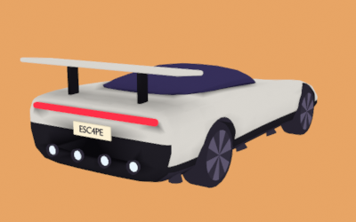
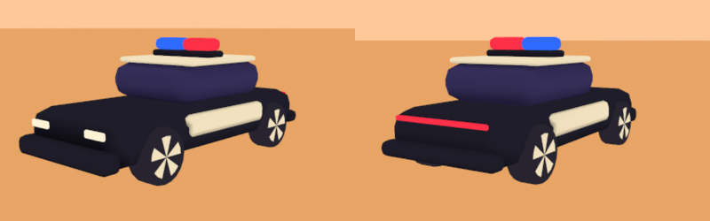
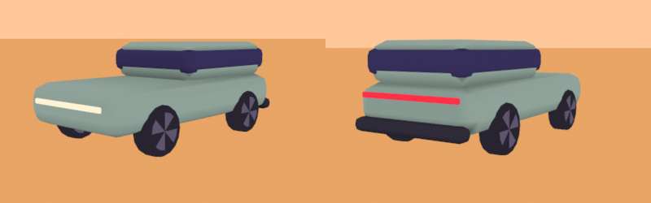
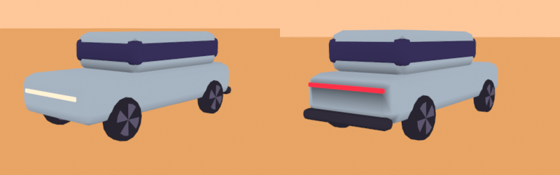
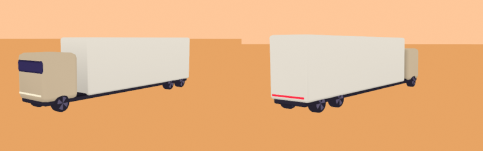

# Art pipeline

Every 3D model in Roadster Escape comes from a Python script in this folder. The script runs in Blender without a window. It builds the model from code, bakes ambient occlusion into vertex colours, exports a GLB, compresses it, and renders a preview image. The generated GLB is committed, so the game builds without Blender.

## Rebuild a model

Install the compression tool once:

```bash
cd art && ~/projects/agentbox/scripts/heavy npm ci
```

Then run the model's script from the repository root:

```bash
~/projects/agentbox/scripts/heavy ~/.local/bin/blender -b --factory-startup \
  --python art/roadster.py -- --out public/models/roadster.glb
```

The run writes `public/models/roadster.glb` and `art/previews/roadster.png`, and prints the triangle count, the size in metres, and the file sizes. It exits non-zero and writes no GLB if the model leaves its triangle budget or its real-world size. On the same Blender build and machine, a rerun writes the same bytes. Another machine can produce a slightly different bake.

## Files

- `palette.py` holds the palette from `docs/ART_DIRECTION.md` and converts its sRGB hex values to linear colours.
- `lib/mesh.py` builds rounded boxes and cylinders, lofts, booleans and flat materials, and paints vertex colours.
- `lib/bake.py` bakes Cycles ambient occlusion and multiplies it into the albedo.
- `lib/export.py` exports the GLB and compresses it with gltf-transform.
- `lib/preview.py` renders a flat-lit Workbench contact sheet under 400 KB.
- `lib/cli.py` parses the script arguments and turns any error into a non-zero exit.
- `lib/kit.py` holds shared parts for the fleet: rounded shells, star-hub wheels, wheel sockets and the size check.
- `roadster.py` builds the Roadster, and `fleet.py` builds the police car, the traffic and the roadblock.

## What a look receives

The models stay look-agnostic, so any look-dev prototype can shade them.

- `COLOR_0` holds the linear albedo with the ambient occlusion baked in, at 16 bits per channel. The base colour factor is 1. There are no textures and no UVs.
- The material name tells the look which role a surface plays. A look swaps in its own material per role.
- Every material is opaque and single-sided.
- A mesh that several nodes share, such as a wheel, carries only its own occlusion, so every copy looks the same.

## Compression and the decoder

`lib/export.py` runs `gltf-transform meshopt`, which writes `EXT_meshopt_compression` with `KHR_mesh_quantization`. The game must register the meshopt decoder that ships with three.js:

```ts
import { GLTFLoader } from 'three/examples/jsm/loaders/GLTFLoader.js';
import { MeshoptDecoder } from 'three/examples/jsm/libs/meshopt_decoder.module.js';

const loader = new GLTFLoader().setMeshoptDecoder(MeshoptDecoder);
```

Meshopt was chosen over Draco for decode speed and setup. The meshopt decoder is a module of about 29 KB (8 KB gzipped) inside three.js, and it needs no worker. The Draco glTF decoder is a WebAssembly file of about 184 KB plus a JavaScript wrapper, which the game would host and run in a worker. Draco packs geometry tighter. When this pipeline landed, the Roadster was 92 KB (67 KB gzipped) with meshopt and 58 KB (47 KB gzipped) with Draco, both with 16-bit colour.

Colours keep 16 bits because they are linear. At 8 bits, the dark trims and their baked occlusion fall into a handful of codes.

Quantization rescales and offsets each node that owns a mesh. So every node whose transform the game reads is a socket: an empty node with a clean transform, whose mesh sits in a child node named `<socket>_mesh`. Do not read or animate the transform of a mesh node.

## The Roadster

`roadster.py` builds the Roadster within 6,000 to 10,000 triangles, at about 4.4 m long, 2.0 m wide and 1.15 m high. In three.js, +Y is up and the nose points to -Z. The origin is on the ground under the centre of the car.

```text
roadster                   root: move it to drive and hop
├── chassis                pivot on the ground under the car centre: rotate about Z to lean, scale Y to squash
│   ├── body               material body: silver upper, satin black lower band, wing on struts, diffuser
│   ├── glass              material glass: the set-back glasshouse
│   ├── lights             material lights: head lights and the full-width tail bar
│   ├── plate              material body: the ESC4PE plate
│   ├── thruster_rear_1-4  socket, left to right across the diffuser
│   ├── thruster_corner_left, thruster_corner_right  socket, under the rear corners, firing down
│   ├── thruster_left_1-2  socket, front to back under the left sill
│   └── thruster_right_1-2 socket, front to back under the right sill
├── wheel_fl               socket, front left
├── wheel_fr               socket, front right
├── wheel_rl               socket, rear left
└── wheel_rr               socket, rear right
```

The six materials are `body`, `glass`, `lights`, `wheel`, `nozzle` and `thruster_mouth`.

- **Thrusters.** The socket origin is at the nozzle mouth. Its local -Z points the way the gas leaves. Rear thrusters fire backwards (+Z). Corner thrusters fire straight down. Side thrusters fire down and 25 degrees outwards. The nozzle mesh has two materials: `nozzle` for the shell and `thruster_mouth` for the mouth disc. The mouth disc has no baked occlusion, so a look can make it glow. All ten thrusters share one mesh and one `thruster_mouth` material, so glow per thruster needs a cloned material or a per-instance uniform.
- **Wheels.** The socket origin is on the axle. The wheel spins about local X with a radius of 0.36 m. Driving forward, `rotation.x` decreases by distance / 0.36. The four wheels share one mesh, with dark six-point star hubs of our own design.
- **Lights.** Head lights use lane paint `#fff4d6` and the full-width tail bar uses police red `#ff3048`. They have no baked occlusion. The file sets no emissive colour, so a look drives the glow from the `lights` material.
- **Body.** A stylised fan take on the car shown on 15 October 2026, not a copy of it. The upper body is silver-grey `#d9d6d0` with flat, crisply creased panels, over a satin black `#1f1d24` lower band and sills. A wing on two struts and a dark diffuser carry the rear. The plate reads `ESC4PE`. No badges or wordmarks. The first red version is kept for comparison in `previews/roadster-v1-red.png`, and its red stays in the palette as a later player colour.




The contact sheet shows, from top left: a front three-quarter view, a rear three-quarter view with the four lit thruster mouths, the side profile, the plan view, and two renders at 20 by 20 pixels scaled up, from the front three-quarter angle and from the chase camera.

## The fleet

`fleet.py` builds the other road users in one Blender run and writes one GLB and one two-view preview each:

```bash
~/projects/agentbox/scripts/heavy ~/.local/bin/blender -b --factory-startup --python art/fleet.py
```

| Asset | GLB | Triangles | Size (W x L x H) |
| --- | --- | --- | --- |
| Police car | `public/models/police.glb` | 2,576 | 2.2 x 5.1 x 2.0 m |
| Hatchback | `public/models/hatch.glb` | 1,672 | 2.0 x 4.1 x 1.5 m |
| SUV | `public/models/suv.glb` | 1,672 | 2.1 x 5.0 x 1.9 m |
| Semi truck | `public/models/semi.glb` | 2,184 | 2.6 x 14.8 x 4.1 m |
| Roadblock | `public/models/roadblock.glb` | 1,492 | 3.4 x 1.3 x 1.3 m |

Every car has a `body` node with materials `body`, `glass`, `lights` and `wheel`, and wheel sockets `wheel_<axle><l|r>` (axles `f` and `r`, plus `m` on the semi) that spin about local X. The police car is black with cream panels, so it never blends with the silver Roadster. Its light bar halves are separate nodes with their own materials, `lightbar_red` and `lightbar_blue`, so a look can flash them. The roadblock fits one 3.7 m lane: a striped beam on two A-frames, a red lamp (material `lights`) and two cones in front of the beam ends. `fleet.py` takes no arguments and always writes into `public/models/` and `art/previews/`. Every export fails unless its materials carry only the role names above.






