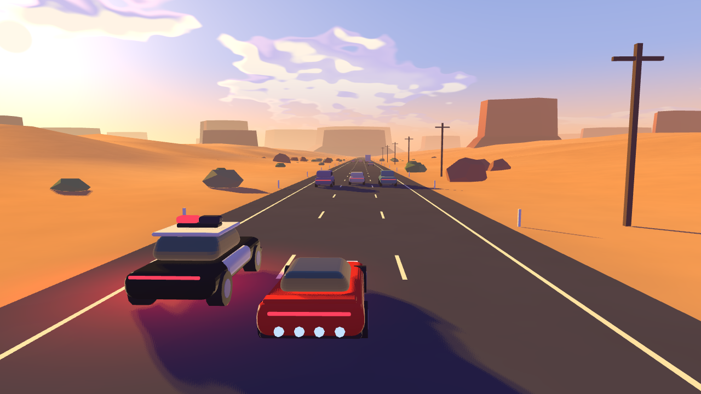
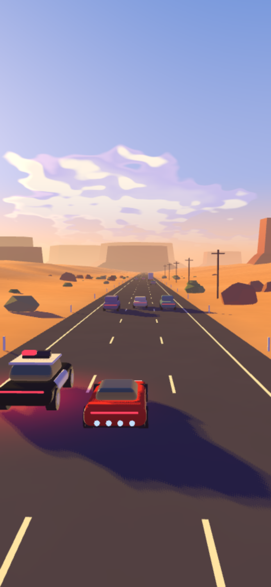
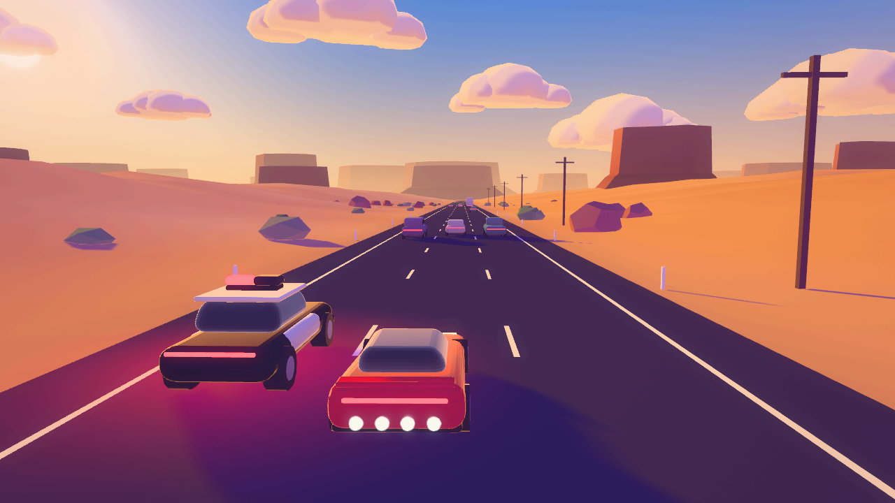
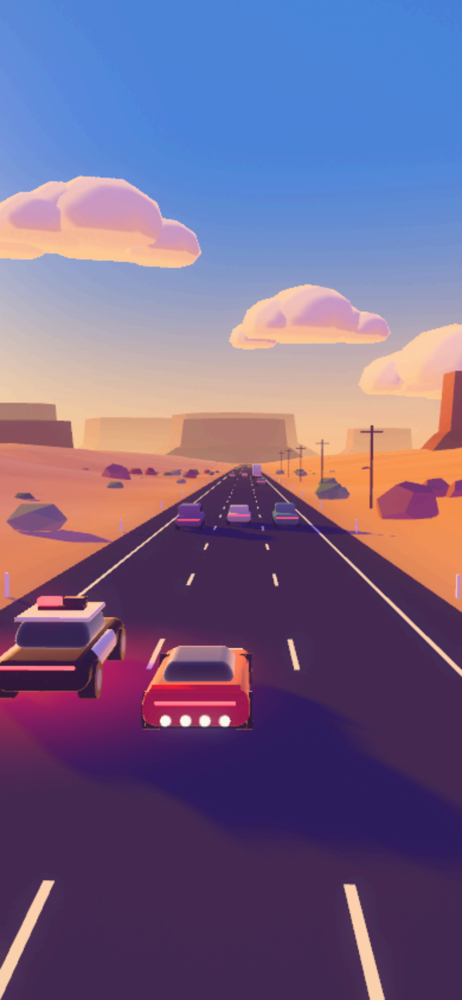
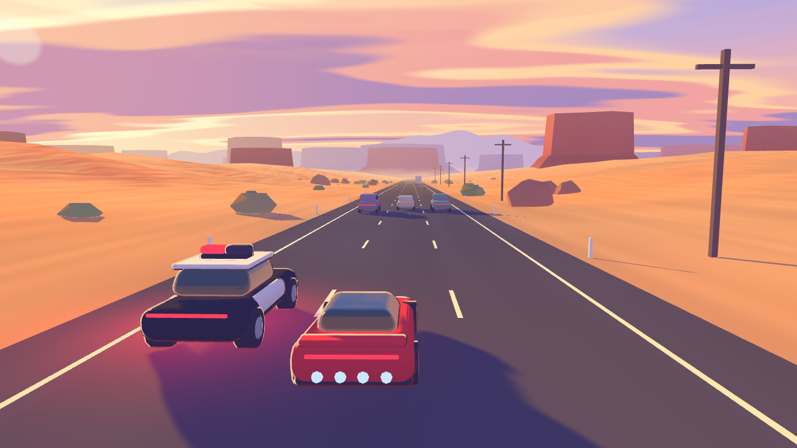
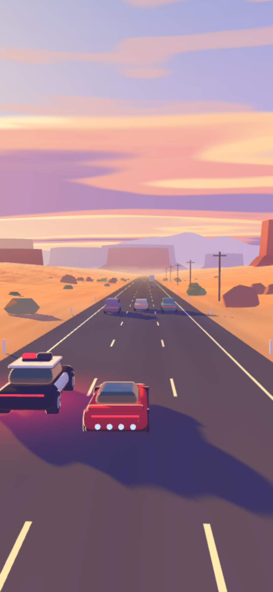

# Look-dev prototypes (phase 1)

Three competing takes on the Roadster Escape look: a Texas highway at golden hour, a placeholder Roadster, a police car lining up for a PIT, and traffic. Hugo picks one; the winner gets ported to `src/render/` in its own pull request. Everything in this folder is throwaway.

## Run

```bash
cd lookdev
~/projects/agentbox/scripts/heavy npm ci
npm run dev   # http://hugo-agentbox-macbookpro:5101
```

| Query | Effect |
| --- | --- |
| `?look=a`, `b`, `c` | Pick the look. The bar at the bottom switches too. |
| `?freeze=12` | Pin time at 12 s so every look shows the same frame. |
| `?debug` | Overlay with draw calls, triangles, frame and CPU time. |
| `?still` | Render one frame after load and after each resize, then stop. |
| `?fps=10`, `?dpr=1` | Cap the frame rate and the pixel ratio. |
| `?clean` | Hide the look switcher. |

`window.__lookdev.bench(n)` renders `n` frames back to back and returns milliseconds per frame, draw calls, and triangles.

## Layout

- `src/common/` holds the shared scene. Every mesh carries a shading role (`ground`, `prop`, `mesa`, `body`, `glass`, `emissive`) and its albedo in vertex colours, so a look only decides how each role is shaded.
- `src/looks/<a|b|c>/` holds one look each.

## The looks

All numbers come from the same frame (`?freeze=12&still&dpr=1`) on this box. The preview browser renders WebGL with SwiftShader on the CPU, so the milliseconds only rank the looks against each other. They say nothing about a phone. Draw calls and triangles include the shadow pass and carry over to a phone as they are.

| Look | Draw calls | Triangles | ms per frame, 1280x720 | ms per frame, 390x844 | Passes |
| --- | --- | --- | --- | --- | --- |
| A | 40 | 49,974 | 194, 199 | 87, 87 | shadow, scene |
| B | 42 | 52,935 | 560, 687 | 229, 232 | shadow, scene to HDR target, one post pass |
| C | 46 | 53,634 | 303, 299 | 113, 165 | shadow, scene |

Each cell is two runs of `bench(3)`.

### A. Shader toon




**Bet.** Everything happens in one custom `ShaderMaterial`, and there is no post pass. Light falls off in three soft bands, shadows take a violet tint, and a warm fresnel rim lights the edges of the two hero cars. Haze thickens near the ground and warms towards the sun. The sky dome paints procedural cumulus in the same shader family.

**Phone cost.** The cheapest of the three. One shadow pass and one scene pass. No render target, no bloom.

**Weaknesses.**
- The clouds are noise, so they read marbled rather than chunky.
- Nothing glows. The police light bar is bright, but without bloom it never spills light.
- Every phase-2 asset has to use this shader, so stock glTF materials cannot be used directly.

### B. Graded lit




**Bet.** Stock three.js materials stay close to their defaults, and the mood comes from light plus one combined post pass. A `MeshToonMaterial` with a soft 3-step ramp, a violet hemisphere fill, and a warm rim. The clouds are real 3D puffs lit by the same sun, which is PEAK's signature. One full-screen shader does bloom from the mip chain, a filmic curve, lift/gamma/gain with violet shadows and warm highlights, a vignette, and dither. `?look=b&tier=low` drops bloom, as `docs/ART_DIRECTION.md` asks for the low tier.

**Phone cost.** The most expensive. One 4x MSAA half-float render target with mips, rebuilt every frame, and 13 texture reads per pixel in the post pass. On this CPU renderer it runs at about 3x the cost of A. Mobile GPUs handle MSAA much more cheaply, so the real gap is probably smaller. That is a guess until it runs on a phone.

**Weaknesses.**
- The patches find and replace text inside three's built-in shaders. A three.js upgrade can break them silently.
- Mip bloom can shimmer on small moving lights. Only still frames were checked.
- It needs a render target that can store half floats. Older phones need an 8-bit fallback with weaker bloom.
- The rim also lands on tyres.

### C. Painterly depth




**Bet.** Atmosphere and layered depth carry the picture, more than lighting does. Four stepped haze planes (near, mid and far mesas plus a lilac far ridge), each with its own flat haze colour. Band edges and cast shadows are pushed around by world-space noise, so the light looks brushed. A stratified sunset sky in three quantised tones. A thin warm outline shell on the two hero cars.

**Phone cost.** In between. No post pass, but more noise per pixel than A, and the outline shells add 5 draw calls and about 5k triangles.

**Weaknesses.**
- With the gameplay camera the mesas are a thin strip on the horizon, so the layering shows less than in a zoomed shot.
- The brushed shadow edges may crawl while the car moves. Only still frames were checked.
- The outline shell can read as a sticker up close.
- The noise uses raw world positions, so long runs need a periodic world-origin reset.

## Recommendation

1. **B, graded lit.** It is the closest to PEAK and to `docs/ART_DIRECTION.md`. Its lit 3D cloud puffs are the strongest single PEAK cue in any of the three. It is the only look where the police light bar blooms and colours the frame, which the art direction asks for. Its stock materials mean phase-2 glTF assets drop in with vertex colours and nothing else. It also already has the low tier the doc describes. The risk is cost: it needs a half-float render target, and its phone frame time is unmeasured.
2. **C, painterly depth.** It has the most distinctive mood. The sunset sky and the stepped haze planes stop a thumb. It loses to B because its strength sits in a thin strip of the frame, and because brushed shadows and outlines in motion are unproven.
3. **A, shader toon.** It is the cleanest and cheapest, but the plainest. Its value is as a low-tier fallback, since it costs about a third of B on the same renderer.

**Suggested path.** Port B into `src/render/`. Graft C's far ridge and stepped per-layer haze onto it, since they cost nothing per pixel. Keep A's single-shader lighting in reserve as the low tier if B misses 60 fps on the test phone.

**Still open.**
- No frame time from a real phone. Every millisecond above comes from a CPU renderer.
- Only still frames were judged. Bloom shimmer (B) and brushed-shadow crawl (C) need a moving check, which the live page at port 5101 allows.
- The sun sits low and ahead-left, so the camera mostly sees the shadow side of the cars. Turning it further to the side would show more lit paint but lose the backlit drama. That is a taste call for Hugo.
